# 教室预约与使用登记系统 — 系统设计文档

> 版本：v1.0  
> 日期：2026-09-14  
> 项目：教室预约与使用登记系统  
> 技术栈：Vue 3 + Spring Boot 3 + MySQL 8 + Redis 7

---

## 1 系统总体设计

### 1.1 系统架构

本系统采用前后端分离的 B/S 架构，前端通过 HTTP 请求与后端 RESTful API 交互，后端通过 MyBatis 访问 MySQL 数据库，并使用 Redis 缓存 JWT Token 实现会话管理。

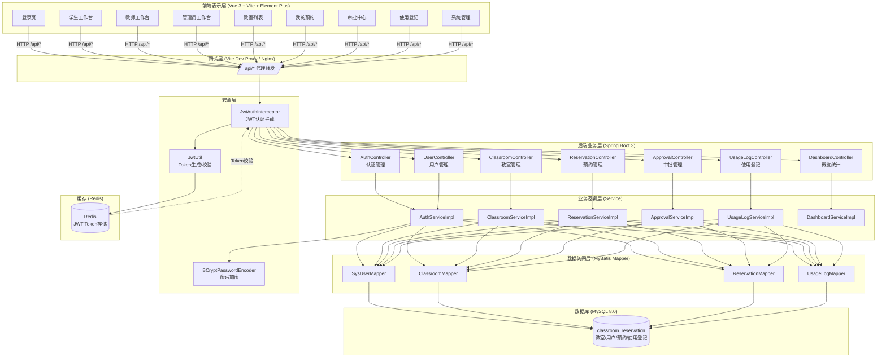

### 1.2 技术路线

| 层次 | 技术选型 | 版本 | 说明 |
|------|----------|------|------|
| 前端框架 | Vue | 3.2.x | 渐进式 JavaScript 框架 |
| 前端构建 | Vite | 5.x | 下一代前端构建工具 |
| UI 组件库 | Element Plus | 2.x | 基于 Vue 3 的组件库 |
| 状态管理 | Pinia | 2.x | Vue 官方推荐的状态管理 |
| 路由 | Vue Router | 4.x | 官方路由管理器 |
| HTTP 客户端 | Axios | 1.x | 拦截器机制统一处理鉴权/错误 |
| 图表 | ECharts | 5.x | 仪表盘数据可视化 |
| 样式 | SCSS | - | CSS 预处理器 |
| 后端框架 | Spring Boot | 3.2.5 | Java 企业级框架 |
| ORM | MyBatis | 3.0.3 | 半自动 ORM，SQL 可控 |
| 数据库 | MySQL | 8.0+ | 关系型数据库 |
| 缓存 | Redis | 6+ | JWT Token 存储与校验 |
| 认证 | JWT (JJWT) | 0.12.5 | 无状态 Token 认证 |
| 密码加密 | BCrypt | - | Spring Security Crypto |
| API 文档 | SpringDoc OpenAPI | 2.3.0 | Swagger 3.0 接口文档 |
| 构建工具 | Maven | 3.8+ | 后端依赖管理与构建 |

### 1.3 模块划分

系统按业务职责划分为 7 个功能模块：

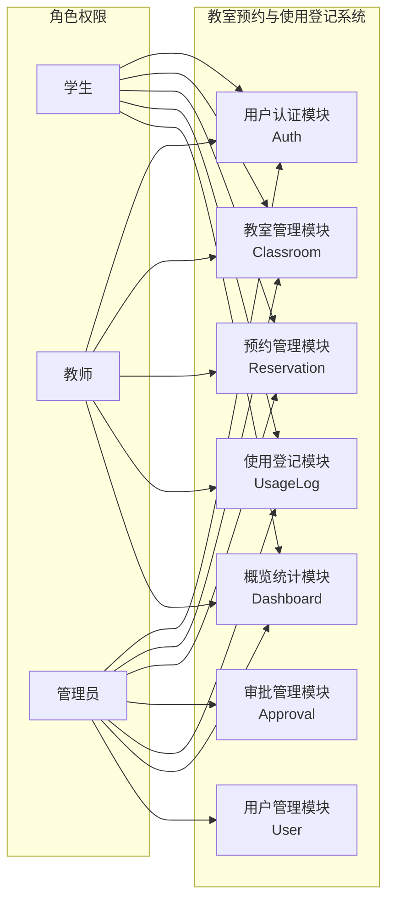

| 模块 | 功能说明 | 可访问角色 |
|------|----------|-----------|
| 用户认证 | 登录、登出、获取用户信息 | 全部 |
| 教室管理 | 教室列表查询、详情、新增/修改/删除/状态变更 | 管理员可增删改，其他角色可查 |
| 预约管理 | 创建预约、我的预约、取消预约 | 全部（管理员可查全部） |
| 审批管理 | 待审批列表、通过审批、驳回审批 | 仅管理员 |
| 使用登记 | 签到、签退、使用记录列表 | 全部（管理员可查全部） |
| 概览统计 | 首页统计卡片、预约状态分布、教室状态分布 | 全部 |
| 用户管理 | 用户CRUD、修改密码 | 仅管理员 |

---

## 2 系统模块详细设计

### 2.1 用户认证模块

**功能描述：** 负责用户登录、登出、身份验证与用户信息获取。

**核心流程 — 登录：**

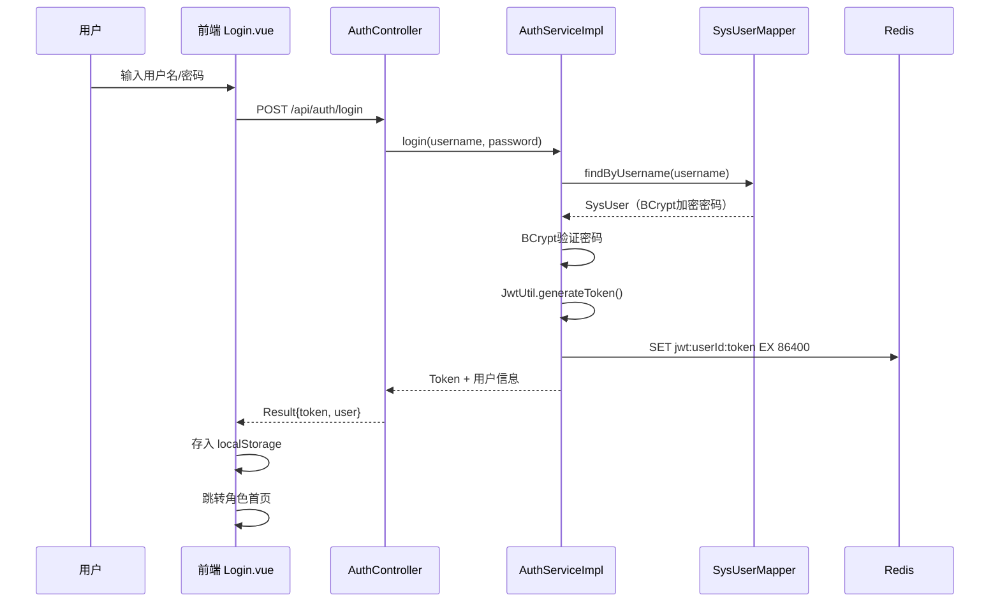

**核心流程 — JWT 鉴权（拦截器）：**

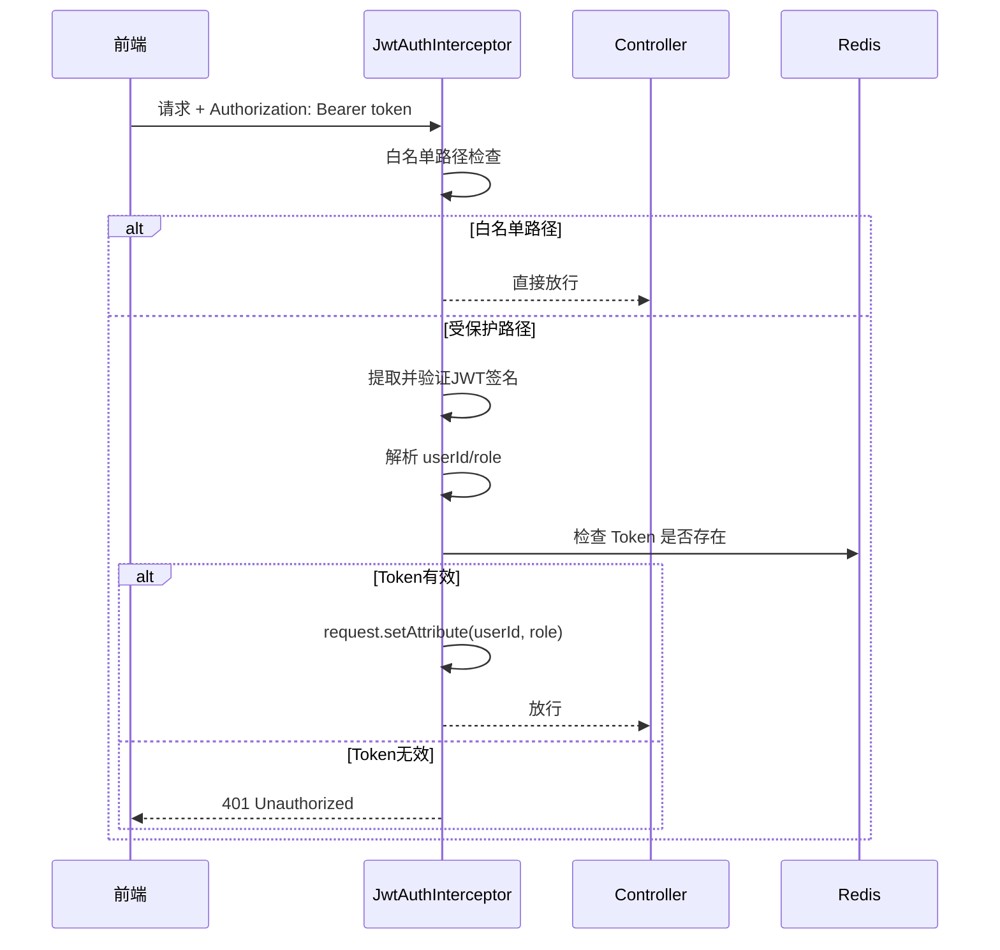

**登出流程：** 删除 Redis 中对应的 JWT key，前端清除 localStorage。

### 2.2 教室管理模块

**功能描述：** 教室信息的 CRUD、状态变更、条件筛选查询。

**教室业务规则：**

| 状态值 | 含义 | 可否被预约 |
|--------|------|-----------|
| AVAILABLE | 可用 | 是 |
| MAINTENANCE | 维护中 | 否 |
| DISABLED | 停用 | 否 |

**教室查询条件：** 楼栋(building)、类型(type)、状态(status)、关键字(keyword)、分页(page/pageSize)

### 2.3 预约管理模块

**功能描述：** 创建预约、查询我的预约、取消预约。

**预约创建校验流程：**

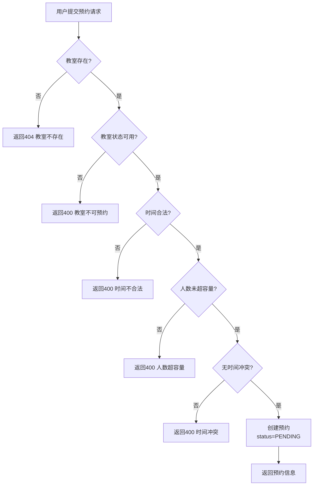

**预约状态机：**

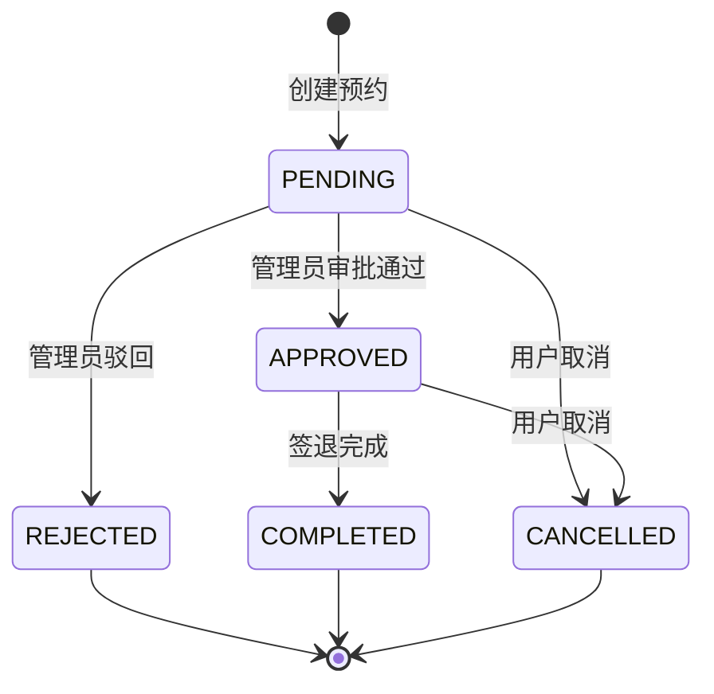

### 2.4 审批管理模块

**功能描述：** 管理员对 PENDING 状态预约进行审批通过或驳回。

**审批业务规则：**
- 仅 ADMIN 角色可访问审批接口
- 只有 PENDING 状态的预约才能被审批
- 驳回操作必须提供 rejectReason（驳回原因）
- 审批操作记录 approverId 和 approveTime

### 2.5 使用登记模块

**功能描述：** 预约通过后的签到、签退流程，以及使用记录查询。

**签到流程：**

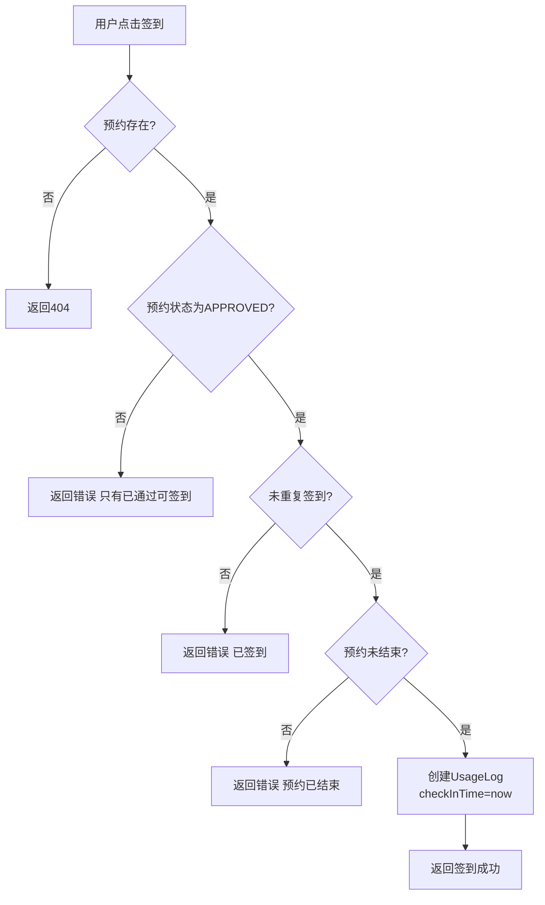

**签退流程：** 创建 UsageLog 记录后，签退时填写实际人数、设备状况、卫生评分、备注，同时将预约状态自动更新为 COMPLETED。

### 2.6 概览统计模块

**功能描述：** 管理员首页统计卡片数据，用于仪表盘展示。

**统计指标：**

| 指标 | 计算方式 |
|------|----------|
| 教室总数 | COUNT(*) FROM classroom |
| 可用教室 | COUNT(*) WHERE status='AVAILABLE' |
| 维护中 | COUNT(*) WHERE status='MAINTENANCE' |
| 总用户数 | COUNT(*) FROM sys_user |
| 总预约数 | COUNT(*) FROM reservation |
| 今日预约 | COUNT(*) WHERE DATE(created_at)=CURDATE() |
| 待审批 | COUNT(*) WHERE status='PENDING' |
| 已通过 | COUNT(*) WHERE status='APPROVED' |
| 已完成 | COUNT(*) WHERE status='COMPLETED' |
| 已驳回 | COUNT(*) WHERE status='REJECTED' |

### 2.7 用户管理模块

**功能描述：** 管理员对系统用户的 CRUD 操作，以及普通用户修改自己的密码。

**用户业务规则：**
- 新增用户时 BCrypt 加密密码
- 用户名唯一，不可重复
- 修改/删除用户仅管理员可操作
- 用户可自行修改密码（需验证旧密码）

---

## 3 数据库设计

### 3.1 ER 图

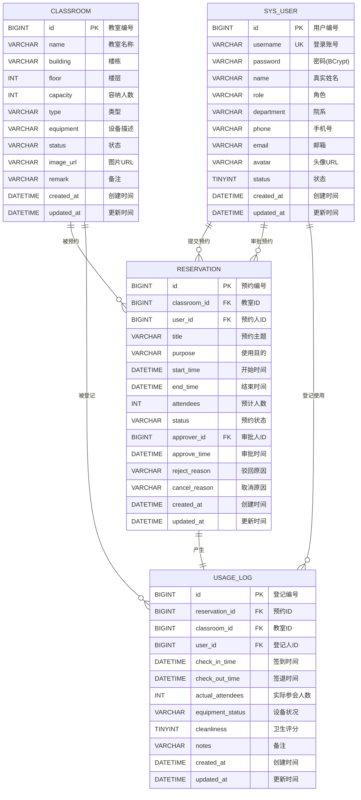

### 3.2 数据表设计

#### 3.2.1 classroom（教室表）

| 字段 | 类型 | 约束 | 说明 |
|------|------|------|------|
| id | BIGINT | PRIMARY KEY AUTO_INCREMENT | 教室编号 |
| name | VARCHAR(50) | NOT NULL | 教室名称，如A201 |
| building | VARCHAR(50) | NOT NULL | 楼栋 |
| floor | INT | | 楼层 |
| capacity | INT | NOT NULL | 容纳人数 |
| type | VARCHAR(20) | NOT NULL | MULTIMEDIA/COMPUTER/LAB/NORMAL |
| equipment | VARCHAR(200) | | 设备描述 |
| status | VARCHAR(20) | NOT NULL DEFAULT 'AVAILABLE' | AVAILABLE/MAINTENANCE/DISABLED |
| image_url | VARCHAR(255) | | 图片URL |
| remark | VARCHAR(200) | | 备注 |
| created_at | DATETIME | DEFAULT CURRENT_TIMESTAMP | 创建时间 |
| updated_at | DATETIME | ON UPDATE CURRENT_TIMESTAMP | 更新时间 |

**索引：** `idx_building_floor(building, floor)`、`idx_status_type(status, type)`

#### 3.2.2 sys_user（用户表）

| 字段 | 类型 | 约束 | 说明 |
|------|------|------|------|
| id | BIGINT | PRIMARY KEY AUTO_INCREMENT | 用户编号 |
| username | VARCHAR(30) | NOT NULL UNIQUE | 登录账号 |
| password | VARCHAR(100) | NOT NULL | 密码（BCrypt加密） |
| name | VARCHAR(30) | NOT NULL | 真实姓名 |
| role | VARCHAR(20) | NOT NULL | ADMIN/TEACHER/STUDENT |
| department | VARCHAR(50) | | 院系 |
| phone | VARCHAR(20) | | 手机号 |
| email | VARCHAR(50) | | 邮箱 |
| avatar | VARCHAR(255) | | 头像URL |
| status | TINYINT(1) | NOT NULL DEFAULT 1 | 1启用/0禁用 |
| created_at | DATETIME | DEFAULT CURRENT_TIMESTAMP | 创建时间 |
| updated_at | DATETIME | ON UPDATE CURRENT_TIMESTAMP | 更新时间 |

**索引：** `idx_role(role)`

#### 3.2.3 reservation（预约表）

| 字段 | 类型 | 约束 | 说明 |
|------|------|------|------|
| id | BIGINT | PRIMARY KEY AUTO_INCREMENT | 预约编号 |
| classroom_id | BIGINT | NOT NULL FK→classroom(id) | 教室ID |
| user_id | BIGINT | NOT NULL FK→sys_user(id) | 预约人ID |
| title | VARCHAR(100) | NOT NULL | 预约主题 |
| purpose | VARCHAR(300) | | 使用目的 |
| start_time | DATETIME | NOT NULL | 开始时间 |
| end_time | DATETIME | NOT NULL | 结束时间 |
| attendees | INT | | 预计人数 |
| status | VARCHAR(20) | NOT NULL DEFAULT 'PENDING' | 状态 |
| approver_id | BIGINT | FK→sys_user(id) | 审批人ID |
| approve_time | DATETIME | | 审批时间 |
| reject_reason | VARCHAR(200) | | 驳回原因 |
| cancel_reason | VARCHAR(200) | | 取消原因 |
| created_at | DATETIME | DEFAULT CURRENT_TIMESTAMP | 创建时间 |
| updated_at | DATETIME | ON UPDATE CURRENT_TIMESTAMP | 更新时间 |

**索引：** `idx_status(status)`、`idx_user_classroom(user_id, classroom_id)`、`idx_time_range(start_time, end_time)`

#### 3.2.4 usage_log（使用登记表）

| 字段 | 类型 | 约束 | 说明 |
|------|------|------|------|
| id | BIGINT | PRIMARY KEY AUTO_INCREMENT | 登记编号 |
| reservation_id | BIGINT | NOT NULL FK→reservation(id) | 预约ID |
| classroom_id | BIGINT | NOT NULL FK→classroom(id) | 教室ID |
| user_id | BIGINT | NOT NULL FK→sys_user(id) | 登记人ID |
| check_in_time | DATETIME | | 签到时间 |
| check_out_time | DATETIME | | 签退时间 |
| actual_attendees | INT | | 实际参会人数 |
| equipment_status | VARCHAR(200) | | 设备状况 |
| cleanliness | TINYINT | | 卫生评分1-5 |
| notes | VARCHAR(300) | | 备注 |
| created_at | DATETIME | DEFAULT CURRENT_TIMESTAMP | 创建时间 |
| updated_at | DATETIME | ON UPDATE CURRENT_TIMESTAMP | 更新时间 |

**索引：** `idx_reservation(reservation_id)`、`idx_classroom_time(classroom_id, check_in_time)`

### 3.3 表关系说明

| 关系 | 类型 | 说明 |
|------|------|------|
| classroom → reservation | 1:N | 一个教室可以有多个预约 |
| sys_user → reservation | 1:N | 一个用户可以提交多个预约 |
| sys_user → reservation(approver) | 1:N | 管理员可以审批多个预约 |
| reservation → usage_log | 1:1 | 每个预约产生一条使用登记 |
| classroom → usage_log | 1:N | 一个教室可以有多条使用登记 |
| sys_user → usage_log | 1:N | 一个用户可以有多条使用登记 |

---

## 4 接口设计

### 4.1 认证接口

| 方法 | 路径 | 说明 | 需鉴权 |
|------|------|------|--------|
| POST | /api/auth/login | 用户登录 | 否 |
| POST | /api/auth/logout | 退出登录 | 是 |
| GET | /api/auth/info | 获取当前用户信息 | 是 |

**POST /api/auth/login 请求体：**
```json
{
  "username": "admin",
  "password": "admin123"
}
```

**POST /api/auth/login 响应体：**
```json
{
  "code": 200,
  "success": true,
  "message": "登录成功",
  "data": {
    "token": "eyJhbGciOiJIUzM4NCJ9...",
    "user": {
      "id": 1,
      "username": "admin",
      "name": "系统管理员",
      "role": "ADMIN",
      "department": "信息中心",
      "avatar": null
    }
  }
}
```

### 4.2 教室接口

| 方法 | 路径 | 说明 | 需鉴权 | 需管理员 |
|------|------|------|--------|----------|
| GET | /api/classrooms | 分页查询教室 | 是 | 否 |
| GET | /api/classrooms/{id} | 教室详情 | 是 | 否 |
| POST | /api/classrooms | 新增教室 | 是 | 是 |
| PUT | /api/classrooms/{id} | 修改教室 | 是 | 是 |
| DELETE | /api/classrooms/{id} | 删除教室 | 是 | 是 |
| PATCH | /api/classrooms/{id}/status | 更新教室状态 | 是 | 是 |

**GET /api/classrooms 查询参数：**

| 参数 | 类型 | 必填 | 说明 |
|------|------|------|------|
| building | String | 否 | 楼栋筛选 |
| type | String | 否 | 类型筛选 |
| status | String | 否 | 状态筛选 |
| keyword | String | 否 | 名称/楼栋模糊搜索 |
| page | int | 否 | 页码，默认1 |
| pageSize | int | 否 | 每页条数，默认10 |

### 4.3 预约接口

| 方法 | 路径 | 说明 | 需鉴权 |
|------|------|------|--------|
| POST | /api/reservations | 创建预约 | 是 |
| GET | /api/reservations/my | 我的预约列表 | 是 |
| GET | /api/reservations | 预约列表（管理员可看全部） | 是 |
| GET | /api/reservations/{id} | 预约详情 | 是 |
| PUT | /api/reservations/{id}/cancel | 取消预约 | 是 |

**POST /api/reservations 请求体：**
```json
{
  "classroomId": 1,
  "title": "数据结构课程",
  "purpose": "日常教学授课",
  "startTime": "2026-09-15T08:30:00",
  "endTime": "2026-09-15T10:00:00",
  "attendees": 45
}
```

**PUT /api/reservations/{id}/cancel 请求体：**
```json
{
  "reason": "临时有事无法参加"
}
```

### 4.4 审批接口

| 方法 | 路径 | 说明 | 需鉴权 | 需管理员 |
|------|------|------|--------|----------|
| GET | /api/approvals/pending | 待审批列表 | 是 | 是 |
| POST | /api/approvals/{id}/approve | 通过审批 | 是 | 是 |
| POST | /api/approvals/{id}/reject | 驳回审批 | 是 | 是 |

**POST /api/approvals/{id}/reject 请求体：**
```json
{
  "rejectReason": "该时段已有其他安排"
}
```

### 4.5 使用登记接口

| 方法 | 路径 | 说明 | 需鉴权 |
|------|------|------|--------|
| POST | /api/usage/check-in | 签到 | 是 |
| POST | /api/usage/check-out | 签退 | 是 |
| GET | /api/usage/list | 使用记录列表 | 是 |

**POST /api/usage/check-in 请求体：**
```json
{
  "reservationId": 1
}
```

**POST /api/usage/check-out 请求体：**
```json
{
  "reservationId": 1,
  "actualAttendees": 24,
  "equipmentStatus": "设备完好",
  "cleanliness": 5,
  "notes": "实验顺利完成"
}
```

### 4.6 统计接口

| 方法 | 路径 | 说明 | 需鉴权 |
|------|------|------|--------|
| GET | /api/dashboard/stats | 获取统计数据 | 是 |

**GET /api/dashboard/stats 响应体：**
```json
{
  "code": 200,
  "success": true,
  "data": {
    "totalClassrooms": 6,
    "availableClassrooms": 5,
    "maintenanceClassrooms": 1,
    "totalUsers": 3,
    "totalReservations": 4,
    "todayReservations": 0,
    "pendingApprovals": 1,
    "approvedReservations": 1,
    "completedReservations": 1,
    "rejectedReservations": 1,
    "cancelledReservations": 0
  }
}
```

### 4.7 用户管理接口

| 方法 | 路径 | 说明 | 需鉴权 | 需管理员 |
|------|------|------|--------|----------|
| GET | /api/users | 分页查询用户 | 是 | 是 |
| POST | /api/users | 新增用户 | 是 | 是 |
| PUT | /api/users/{id} | 修改用户 | 是 | 是 |
| DELETE | /api/users/{id} | 删除用户 | 是 | 是 |
| PUT | /api/users/password | 修改密码 | 是 | 否 |

### 4.8 统一响应格式

```json
{
  "code": 200,
  "success": true,
  "message": "操作成功",
  "data": {}
}
```

### 4.9 统一分页响应格式

```json
{
  "code": 200,
  "success": true,
  "data": {
    "records": [],
    "total": 100,
    "page": 1,
    "pageSize": 10
  }
}
```

### 4.10 错误码说明

| HTTP 状态码 | code | 说明 |
|-------------|------|------|
| 200 | 200 | 成功 |
| 400 | 400 | 请求参数错误 |
| 401 | 401 | 未登录/Token无效/Token过期 |
| 403 | 403 | 无权限执行此操作/账号被禁用 |
| 404 | 404 | 资源不存在 |
| 500 | 500 | 系统内部错误 |

---

## 5 详细设计

### 5.1 预约创建程序流程图

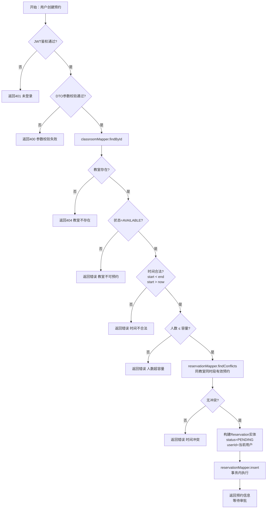

### 5.2 审批通过时序图

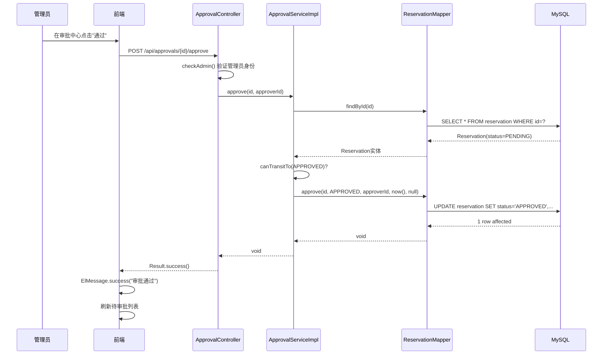

### 5.3 签到/签退时序图

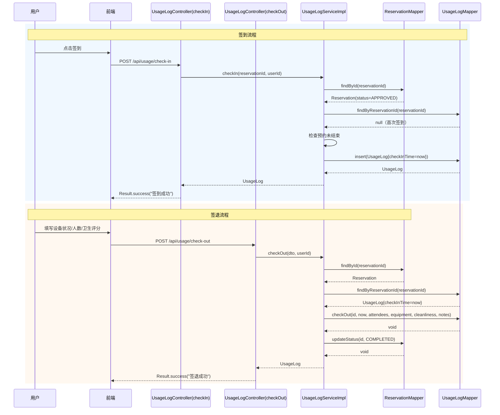

### 5.4 组件内部结构

#### 5.4.1 JwtAuthInterceptor 核心逻辑

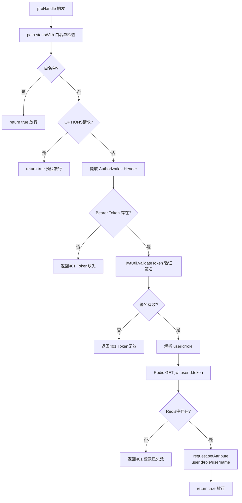

#### 5.4.2 ReservationStatus 状态机

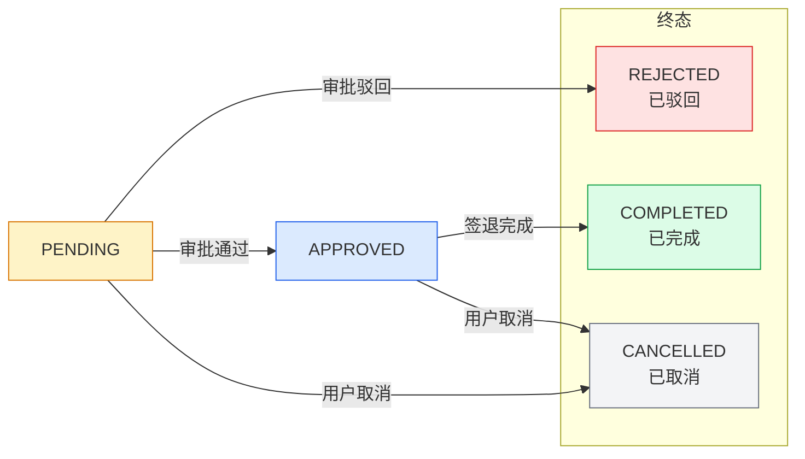

---

## 附录 A：初始数据

### A.1 教室初始数据（6间）

| id | name | building | floor | capacity | type | status |
|----|------|----------|-------|----------|------|--------|
| 1 | A201 | 教学楼A | 2 | 60 | MULTIMEDIA | AVAILABLE |
| 2 | A202 | 教学楼A | 2 | 40 | NORMAL | AVAILABLE |
| 3 | B301 | 教学楼B | 3 | 80 | MULTIMEDIA | AVAILABLE |
| 4 | B302 | 教学楼B | 3 | 50 | COMPUTER | MAINTENANCE |
| 5 | C101 | 实验楼C | 1 | 30 | LAB | AVAILABLE |
| 6 | C102 | 实验楼C | 1 | 35 | LAB | AVAILABLE |

### A.2 用户初始数据（3个）

| id | username | name | role | department | 密码 |
|----|----------|------|------|------------|------|
| 1 | admin | 系统管理员 | ADMIN | 信息中心 | admin123 |
| 2 | teacher01 | 王老师 | TEACHER | 计算机学院 | 123456 |
| 3 | student01 | 张同学 | STUDENT | 计算机学院 | 123456 |

### A.3 预约初始数据（4条）

| id | classroom_id | user_id | title | start_time | end_time | status |
|----|-------------|---------|-------|------------|----------|--------|
| 1 | 1 | 2 | 数据结构课程 | 2026-09-08 08:30 | 2026-09-08 10:00 | PENDING |
| 2 | 3 | 2 | 毕业设计答辩 | 2026-09-08 14:00 | 2026-09-08 17:00 | APPROVED |
| 3 | 2 | 3 | 社团活动例会 | 2026-09-09 19:00 | 2026-09-09 21:00 | REJECTED |
| 4 | 5 | 3 | 物理实验课 | 2026-09-07 10:00 | 2026-09-07 12:00 | COMPLETED |

### A.4 使用登记初始数据（1条）

| id | reservation_id | check_in_time | check_out_time | actual_attendees | equipment_status | cleanliness |
|----|---------------|---------------|----------------|------------------|------------------|-------------|
| 1 | 4 | 2026-09-07 09:55 | 2026-09-07 12:05 | 24 | 设备完好 | 5 |

---

## 附录 B：Swagger 文档地址

后端启动后访问：**http://localhost:8080/swagger-ui.html**

可在线测试所有 API 接口。

---

> 文档完 — 教室预约与使用登记系统 v1.0
